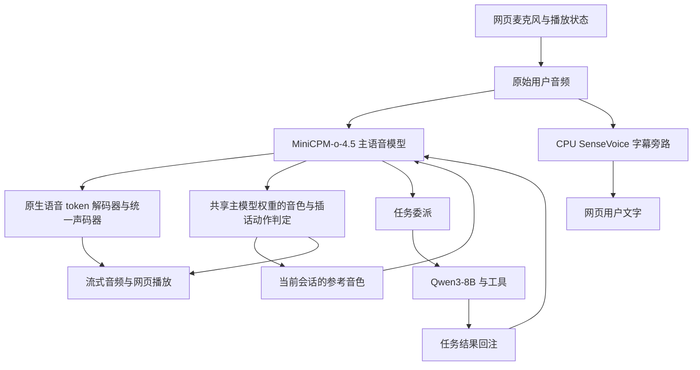

# VoiceDuplexLab

中文原生端到端语音对话研究项目。主语音模型采用 **MiniCPM-o-4.5**，任务后台采用 **Qwen3-8B**。支持网页麦克风对话、字幕、双向录音、参考音色管理，以及联合训练与断点恢复。

当前版本为 **v8 / winik / 第1500步联合训练候选**，更新于2026年11月12日。当前仓库提供训练、推理、网页和资源管理源码。实验权重、优化器状态与训练素材保存在独立本地归档中，运行该候选需要另行恢复这些资源。

## 当前验证状态

| 项目 | 实现与验证情况 |
| --- | --- |
| 网页语音对话 | A100 80GB 上完成模型加载、HTTP 健康检查、真实 WebSocket 会话初始化及槽位回收检查 |
| 普通中文交流 | 早期候选获得过真人正常沟通反馈，v8 的开放问题质量仍需独立试听验收 |
| 角色 winik | 系统提示已接入，普通介绍使用名字与性格，日常保持角色口吻，明确追问真实身份时说明是虚拟角色 |
| 用户字幕与会话录音 | 支持双方文字、浏览器内录音、预听与下载 |
| 上传参考音色 | 支持参考录音上传、用户归属校验、选择音色和会话独立缓存 |
| 口头模仿与恢复默认声线 | 同一主模型内部动作判定已接入，合成语音回放中“现在模仿我的声音说话”触发了实际参考更新，真人稳定性待验收 |
| 情绪理解与发声 | 已加入感知辅助监督和情绪语音联合训练，明显度、自然度及换声后的声纹保持待验收 |
| 原生语速控制 | 请求进入主模型发声条件，实际速度变化及数值精度待验收 |
| 唱歌 | 已加入真实歌声监督，旋律、歌词与音色效果待试听验收 |
| 附和与真正插话 | 支持同模型三类决策和浏览器清理旧音频，短“嗯”的回放未打断，真正插话后的抢答问题仍待修复验收 |
| 后台工具 | 支持澄清、委派、等待期间交流、取消、结果回注与失败反馈，工具流程需继续做真实会话回归 |
| 续训 | 联合检查点保存适配权重、优化器及随机状态，支持累计步数恢复 |

已知问题包括换声确认后可能重复问候，真正插话后可能过早起答或复述用户半句。情绪、唱歌、语速和智能打断的质量应以连续真实录音验收。训练损失及动作事件仅能说明对应测试的结果。

## 架构



- 用户原始声音直接进入主语音模型，主模型负责闲聊和语音理解。
- 普通说话、情绪语音和非语言发声使用同一原生语音生成路径。参考声音同时提供主模型上下文和原生声码器条件。
- 音色与插话决策通过共享主模型权重的额外推理完成。当前实现会增加推理开销，控制结果再交给会话状态机执行。
- 网页风格和速度设置转换成主模型指令。`native_e2e` 推理路径直接生成相应语音，离线数据制作中可以使用 FFmpeg。
- 字幕由 CPU SenseVoice 旁路转写。原生模式中的字幕文本用于显示，主语义和音色动作使用原始音频。
- 主模型输出 `@@TASK ... @@END` 委派需要执行的任务。后台模型返回事实、来源或失败原因，主模型再组织口语回应。
- 每个语音槽位持有独立模型副本，一次服务一个会话。多用户音色按令牌归属隔离，并发数量取决于已配置槽位及可用显存。

默认角色名为 **winik**，温暖、机灵、有主见、带一点幽默。角色提示在 `voice_lab/prompts.py` 的 `WINIK_PERSONA` 中定义。

## 环境

- 服务与训练使用 Linux、NVIDIA CUDA 和 Python 3.11。
- 本轮验证环境为单张 A100 80GB、PyTorch 2.7.1+cu128、Transformers 4.51.3、PEFT 0.15.2、minicpmo-utils 1.0.5。
- 固定依赖详见 `pyproject.toml`，CUDA 驱动由服务器提供。
- 主语音模型和后台同时运行时需要为两者预留显存。其他 GPU 的显存占用与实时速度需实测。
- 浏览器访问远程麦克风需要 HTTPS。服务默认监听 `127.0.0.1`，可使用带登录保护的 HTTPS 反向代理。

## 安装与下载

```bash
git clone https://github.com/MR-MaoJiu/VoiceDuplexLab.git
cd VoiceDuplexLab
bash quickstart.sh setup-gpu
bash quickstart.sh download --models-only
bash quickstart.sh setup-asr
```

模型下载固定到以下版本。

| 用途 | 来源 | Revision |
| --- | --- | --- |
| 主语音模型 | openbmb/MiniCPM-o-4_5 | `fb09628e98b1f55d8d5b863e0eccfcdd11bff499` |
| 工具后台 | Qwen/Qwen3-8B | `b968826d9c46dd6066d109eabc6255188de91218` |

[MiniCPM-o-4.5 模型卡](https://huggingface.co/openbmb/MiniCPM-o-4_5) · [Qwen3-8B 模型卡](https://huggingface.co/Qwen/Qwen3-8B)

## 启动网页

默认配置 `configs/default.yaml` 可加载原始基座。先复制一份实验配置，再按实际服务器资源路径调整。

```bash
cp configs/default.yaml configs/local.yaml
```

例如本地权重及联合候选的配置字段如下。运行原始基座时可省略两个适配器字段。加载联合候选时，`adapter` 必须对应训练时的语言初始化，`native_adapter` 指向完整联合检查点。

```yaml
model:
  architecture: native_e2e
  path: /path/to/models/MiniCPM-o-4_5
  revision: fb09628e98b1f55d8d5b863e0eccfcdd11bff499
  adapter: /path/to/language-initialization
  native_adapter: /path/to/checkpoints/step-0001500
  device: cuda:0
  dtype: bfloat16
  decode_mode: greedy
  reference_audio_in_context: true
  voice: null
  max_speak_tokens: 40
  context_high: 7000
  context_low: 5000
```

在复制的完整配置中，还需设置以下字段。

```yaml
backend:
  weights_path: /path/to/models/Qwen3-8B
asr:
  enabled: true
  model_dir: /path/to/models/SenseVoice-int8
  num_threads: 2
```

在两个终端分别启动后台和网页。下面的 `backend-transformers` 复用已安装的训练环境。

```bash
# 终端一
VOICE_CONFIG=configs/local.yaml bash quickstart.sh backend-transformers

# 终端二
VOICE_CONFIG=configs/local.yaml bash quickstart.sh web
```

本机打开 `http://127.0.0.1:8765`。远程服务器使用对应的 HTTPS 代理入口。点击“开始对话”并允许麦克风，音频会直接进入语音模型。页面提供参考声音上传、选择、表达风格、速度以及录音预听与下载。

单机私有测试可使用默认空令牌。公开监听时，服务要求配置令牌或用户映射。可以将令牌保存在环境变量中。

```bash
export VOICE_SERVER_TOKEN='自行生成的长随机令牌'
VOICE_CONFIG=configs/local.yaml bash quickstart.sh web
```

多用户配置使用环境变量名映射，令牌值在运行环境中设置。

```yaml
server:
  users:
    alice: ALICE_VOICE_TOKEN
    bob: BOB_VOICE_TOKEN
  worker_devices: [cuda:0]
```

录音由当前浏览器页面保存，用户与模型分别置于左右声道。需要保留会话录音时，结束对话后在页面下载。临时模仿参考属于当前会话，已上传的参考声音保存在配置的 `server.voice_store`。

## 原生联合训练

联合目标包含主语言交叉熵、语音 token 交叉熵、统一声码器流匹配和可选控制辅助交叉熵。语音 token 损失保留到主语言骨干的梯度。声码器流匹配当前使用预计算语义条件。

训练模块包括语言骨干 LoRA、语音 token 解码器 LoRA、语义投影层和 Flow 解码器 LoRA。输入音频编码器、输入词嵌入、Flow 编码器及 HiFi-GAN 保持冻结。

### 数据格式

训练清单为 JSONL，每条包含唯一 `id`，相对音频路径以清单所在目录为起点。清单需要同时包含 `train` 和 `eval`。下面展示一条带目标语音的情绪训练记录。

```json
{"id":"happy-001","split":"train","speaker":"speaker-a","emotion":"happy","user_audio":"audio/request.wav","reference_audio":"audio/reference-neutral.wav","outputs":[{"text":"今天真的很开心！","audio":"audio/response-happy.wav"}]}
```

`outputs` 按原生输出单元排列，每块语音对应其文字。纯任务控制单元可只提供 `text`。完整流式对话可以使用 `units`，辅助音频控制标签使用 `controls`，具体结构见 `voice_lab/train_native.py` 和对应测试。

参考录音应与目标片段分开。情绪训练需要覆盖同一声线、不同情绪及独立台词，音色泛化需要未见说话人评估。输入情绪理解还需包含用户声音情绪和合适回应的监督。

### 准备与训练

在完整配置中填写基座、本地资源及所需语言初始化。特征编译器版本为4，原生自动插入的 `</unit>` 已从强制 token 监督中屏蔽。

```bash
bash quickstart.sh native-prepare \
  --config configs/local.yaml \
  --manifest data/native/manifest.jsonl \
  --prepared data/native-prepared

bash quickstart.sh native-train \
  --config configs/local.yaml \
  --prepared data/native-prepared \
  --output runs/native-joint \
  --steps 1500 \
  --learning-rate 5e-5 \
  --language-learning-rate 2e-6 \
  --flow-learning-rate 1e-4 \
  --save-every 100
```

`--steps` 为累计更新次数。使用 `--resume` 时应保持训练特征及超参数一致。

```bash
bash quickstart.sh native-train \
  --config configs/local.yaml \
  --prepared data/native-prepared \
  --output runs/native-joint \
  --steps 2000 \
  --learning-rate 5e-5 \
  --language-learning-rate 2e-6 \
  --flow-learning-rate 1e-4 \
  --save-every 100 \
  --resume runs/native-joint/step-0001500
```

`--initialize` 从兼容的联合权重建立新优化器任务。`--resume` 恢复优化器及 Python、PyTorch、CUDA 随机状态。SIGTERM/SIGINT 会在当前更新后保存断点，平台强制关机需要依靠此前已保存的检查点。

联合检查点包含 `llm_lora/`、`tts_lora/`、`projector.pt`、`flow_lora/`、`state.pt`、`native_metadata.json` 和 `metrics.json`。加载时校验基座 revision 与语言初始化指纹。

### 本轮实验范围

v8 混合清单包含702条记录，588条训练、114条验证，覆盖情绪语句、哭笑片段、歌声、音色控制、插话、角色、情绪感知以及正常对话保留。正常对话保留条目包含多单元对话，记录数与音频总时长需分别统计。

第1500步记录的混合验证损失约为3.8958。该值随任务权重和数据构成变化。不同特征编译版本、监督标签或数据清单的损失应分别解读。

当前情绪生成样本主要覆盖中性、开心、悲伤、愤怒与哭笑。RAVDESS 的八类情绪用于感知辅助监督。歌声生成采用 GTSinger 的60条片段，48条训练、12条验证。这些子集仍需扩充和持续验收。

## 素材与许可

| 来源 | 本项目用途 | 数据许可 |
| --- | --- | --- |
| SmoothConv | 自然中文对话及历史训练数据准备 | CC BY-NC 4.0 |
| SMIIP-NV | 情绪语句与非语言发声 | CC BY-NC-SA 4.0 |
| RAVDESS | 多情绪感知辅助监督 | CC BY-NC-SA 4.0 |
| GTSinger | 真实歌声、配对说话参考及音符时长标注 | CC BY-NC-SA 4.0，并保留数据集附加条款 |

[聊天语料](https://huggingface.co/datasets/qualialabsAI/SmoothConv) · [SMIIP-NV](https://huggingface.co/datasets/xunyi/SMIIP-NV) · [RAVDESS](https://zenodo.org/records/1188976) · [GTSinger](https://huggingface.co/datasets/AaronZ345/GTSinger)

固定数据版本及文件校验记录随实验资源归档保存。部分用户请求音频在离线制备阶段使用系统合成声音，来源通过样本 `provenance` 标记。后台结果训练样本可能使用显式模拟结果，真实工具验收需要独立执行。

源码采用 Apache License 2.0，详见 `LICENSE` 和 `NOTICE`。模型权重、数据、参考音频及派生实验分别遵循对应许可。发布派生权重或使用实验结果时，需要保留相关署名与限制，并核对实际使用范围。

## 其他工具入口

- `bash quickstart.sh prefetch` 准备旧版一键实验的下载资源。
- `bash quickstart.sh restore-resources /path/to/uploaded-resources` 校验并恢复预上传分卷。
- `scripts/local_resources.py` 负责本地资源下载和打包。
- `scripts/upload_resources.py` 负责已授权平台共享存储上传。
- `bash quickstart.sh emotion-resources --output data/emotion/RAVDESS` 下载补充情绪素材。
- `bash quickstart.sh oneclick` 为早期小规模语言 LoRA 流程，当前原生联合训练使用上述 `native-prepare` 和 `native-train`。

这些工具分别覆盖各自资源链路。v8 混合清单与完整训练素材需要按实际归档恢复或依据数据格式自行准备。

## 代码布局与检查

| 路径 | 职责 |
| --- | --- |
| `voice_lab/native.py` | 原始音频驱动、统一发声、音色动作及插话控制 |
| `voice_lab/voice_action.py`、`interaction_action.py` | 共享主模型权重的内部动作判定 |
| `voice_lab/floor.py` | 发言边界、待答代次和起答管理 |
| `voice_lab/server.py`、`web/` | WebSocket、字幕、音色管理、浏览器录音与播放 |
| `voice_lab/backend.py`、`hf_backend.py` | 异步工具协作与后台模型服务 |
| `voice_lab/train_native.py`、`native_flow.py` | 联合特征编译、损失、检查点与原生声码器训练 |
| `voice_lab/prompts.py` | winik 身份、主语音与后台提示词 |
| `scripts/`、`tests/` | 环境、下载、资源管理、历史实验及回归测试 |

```bash
.venv/bin/python -m pytest -q tests
node --check voice_lab/web/app.js
```

CPU 回归覆盖协议、状态、梯度路径和资源处理。GPU 生成回放、真实工具执行以及真人听感需要另外验证。
